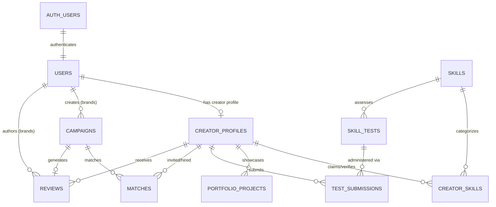

# AI Content Creator Marketplace - Backend & Database Architecture

## 1. Architecture Overview
This backend foundation is built using **Supabase PostgreSQL 15+**, **Supabase Auth**, **Supabase Storage**, **Next.js 16 (App Router)** Server Actions & API Route Handlers, **TypeScript**, and **Zod**.

### Key Highlights:
- **10 Core Tables** with foreign key cascades, check constraints, and custom PostgreSQL enum types.
- **Supabase Row Level Security (RLS)** active across every table with role-based access controls (`creator`, `brand`, `admin`).
- **Supabase Storage**: 2 provisioned buckets (`portfolio-media` with public CDN, `test-submissions` with private scoped access).
- **Zod Validation**: Exhaustive input schema validations for all mutations.
- **Server Actions & REST Endpoints**: Typed Server Actions and `/api/v1/*` routes for campaigns, portfolio, test evaluations, and upload workflows.

---

## 2. Database Schema Reference

### Core Tables & Types
```sql
user_role: 'creator' | 'brand' | 'admin'
verification_status_type: 'claimed' | 'portfolio_evidence' | 'test_verified' | 'client_verified'
test_difficulty: 'beginner' | 'intermediate' | 'advanced' | 'expert'
test_submission_status: 'pending' | 'evaluating' | 'passed' | 'failed'
campaign_status: 'draft' | 'active' | 'in_progress' | 'completed' | 'cancelled'
match_status: 'suggested' | 'invited' | 'accepted' | 'declined' | 'hired'
```

| Table | Primary Key | Description | Relationships |
|---|---|---|---|
| `users` | `id UUID` | Profile linked directly to `auth.users(id)` | 1:1 with `auth.users`, 1:1 with `creator_profiles` |
| `creator_profiles` | `id UUID` | Creator public profile, rates, experience, bio | FK `user_id` -> `users(id)` |
| `skills` | `id UUID` | Canonical skill catalog & difficulty weights | 1:N with `creator_skills`, 1:N with `skill_tests` |
| `creator_skills` | `id UUID` | Junction table tracking 4-tier verification status | FK `creator_profile_id`, FK `skill_id`, FK `verified_by` |
| `portfolio_projects` | `id UUID` | Portfolio items with media, prompts, and evidence | FK `creator_profile_id`, Array FK `linked_skill_ids` |
| `skill_tests` | `id UUID` | Benchmark assessments with questions and rubrics | FK `skill_id` -> `skills(id)` |
| `test_submissions` | `id UUID` | Creator test answers, evidence, and scores | FK `test_id`, FK `creator_profile_id`, FK `evaluated_by` |
| `campaigns` | `id UUID` | Brand campaigns with budget ranges and briefs | FK `brand_id` -> `users(id)` |
| `matches` | `id UUID` | AI-matched and invited creator-campaign links | FK `campaign_id`, FK `creator_profile_id` |
| `reviews` | `id UUID` | Post-collaboration ratings and skill verification | FK `campaign_id`, FK `brand_id`, FK `creator_profile_id` |

---

## 3. Entity-Relationship Model (Mermaid)



---

## 4. Supabase Row Level Security (RLS) Policy Matrix

| Table | SELECT | INSERT | UPDATE | DELETE |
|---|---|---|---|---|
| `users` | Authenticated users | System trigger on `auth.users` | Self (`id = auth.uid()`) | Admin only |
| `creator_profiles` | Public (anyone) | Self (`user_id = auth.uid()`) | Self (`user_id = auth.uid()`) | Admin only |
| `skills` | Public (active skills) | Admin only | Admin only | Admin only |
| `creator_skills` | Public | Creator owner (`claimed`/`evidence`) | Creator owner (evidence only) | Creator owner or Admin |
| `portfolio_projects` | Public | Creator owner | Creator owner | Creator owner |
| `skill_tests` | Authenticated | Admin only | Admin only | Admin only |
| `test_submissions` | Creator owner or Admin | Creator owner (`status = pending`) | Admin/Evaluator only | Admin only |
| `campaigns` | Active campaigns or Brand owner | Brand owner (`role = 'brand'`) | Brand owner | Brand owner (drafts/cancelled) |
| `matches` | Matched Creator, Brand owner, Admin | Brand owner or Admin | Creator (accept/decline), Brand (hire) | Admin only |
| `reviews` | Public | Brand owner (completed campaign) | Brand owner | Admin only |

---

## 5. Supabase Storage Architecture

### Buckets:
1. **`portfolio-media`** (Public):
   - **MIME Types**: `image/*`, `video/mp4`, `video/webm`, `audio/*`
   - **File Size Limit**: 50 MB
   - **Read Policy**: Public CDN access for marketplace viewers.
   - **Write Policy**: Authenticated creators can only write into `portfolio-media/{auth.uid()}/*`.
2. **`test-submissions`** (Private):
   - **MIME Types**: `image/*`, `video/mp4`, `application/pdf`, `application/zip`, `text/plain`, `application/json`
   - **File Size Limit**: 100 MB
   - **Read Policy**: Creator owner (`test-submissions/{auth.uid()}/*`) and Admin evaluators.
   - **Write Policy**: Authenticated creators can write to `test-submissions/{auth.uid()}/*`.

---

## 6. Server Actions & API Reference

### Server Actions
- **Creator Actions** ([`actions/creator-actions.ts`](file:///c:/Users/sksab/OneDrive/Desktop/AI-content%20creator%20market%20place%202/actions/creator-actions.ts)):
  - `updateCreatorProfileAction(input)`: Validated with `updateCreatorProfileSchema`.
  - `claimSkillAction(input)`: Validated with `claimSkillSchema`.
  - `createPortfolioProjectAction(input)`: Validated with `createPortfolioProjectSchema`.
  - `submitSkillTestAction(input)`: Validated with `submitSkillTestSchema`.
  - `respondToMatchAction(input)`: Validated with `respondMatchSchema`.
- **Brand Actions** ([`actions/brand-actions.ts`](file:///c:/Users/sksab/OneDrive/Desktop/AI-content%20creator%20market%20place%202/actions/brand-actions.ts)):
  - `createCampaignAction(input)`: Validated with `createCampaignSchema`.
  - `inviteCreatorAction(input)`: Validated with `inviteCreatorSchema`.
  - `hireCreatorAction(input)`: Validated with `hireCreatorSchema`.
  - `createReviewAction(input)`: Validated with `createReviewSchema` (auto-upgrades skills to `client_verified`).
- **Admin Actions** ([`actions/admin-actions.ts`](file:///c:/Users/sksab/OneDrive/Desktop/AI-content%20creator%20market%20place%202/actions/admin-actions.ts)):
  - `evaluateTestSubmissionAction(input)`: Evaluates test, auto-elevates skill to `test_verified` with score.
  - `verifySkillAction(input)`: Manual override and auditing.

### REST API Endpoints
- `GET /api/v1/campaigns` - Query campaigns with filters & pagination
- `POST /api/v1/campaigns` - Create brand campaign
- `GET /api/v1/campaigns/[id]` - Campaign details with match list
- `PATCH /api/v1/campaigns/[id]` - Update campaign
- `DELETE /api/v1/campaigns/[id]` - Remove campaign
- `GET /api/v1/portfolio?creatorId=...` - List portfolio items
- `POST /api/v1/portfolio` - Create portfolio project
- `PATCH /api/v1/portfolio/[id]` - Edit portfolio project
- `DELETE /api/v1/portfolio/[id]` - Delete portfolio project
- `POST /api/v1/tests/submissions` - Submit skill test
- `POST /api/v1/admin/evaluations` - Evaluator grading
- `POST /api/v1/storage/upload-url` - Generate presigned storage upload URL
